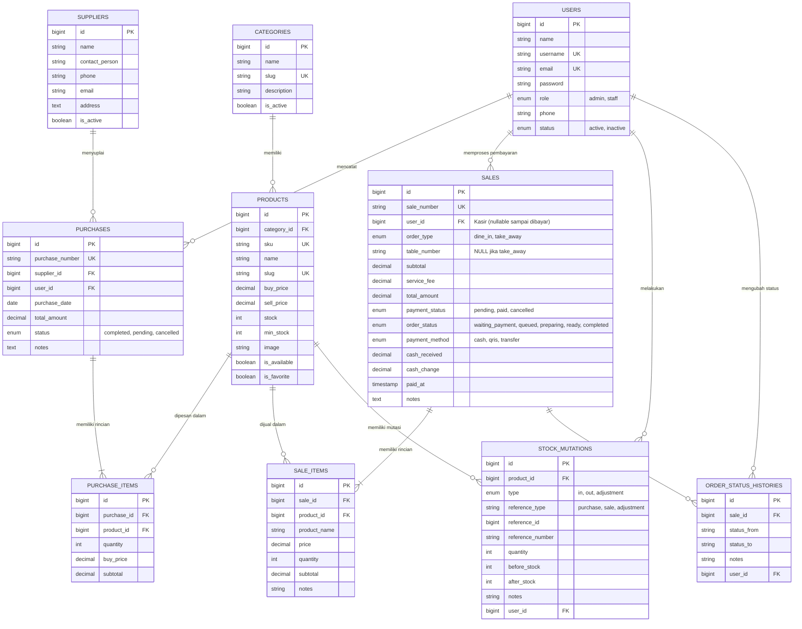

# 🍜 Sistem Informasi Warmindo Terintegrasi
### Berbasis Laravel 10 + MySQL dengan Pemesanan Online, Kasir Terintegrasi, KDS Antrean Dapur, 7 Laporan Interaktif (Dual Mode), dan AI Business Assistant

> **Project UTS Pemrograman Web 2**  
> Menggabungkan ketentuan wajib UTS PPT dengan spesifikasi operasional Warmindo (Warung Makan Indomie) modern dengan implementasi UI/UX 100% presisi sesuai desain.

---

## 📌 Ringkasan Sistem

Sistem Informasi Warmindo adalah platform terpadu untuk mendigitalkan seluruh siklus bisnis kuliner Warmindo:
1. **Publik / Customer**: Pemesanan mandiri tanpa login, katalog filter/kategori, keranjang dinamis, pemilihan layanan Dine In (wajib nomor meja) vs Take Away (meja `NULL`), dan checkout instan dengan kode unik pesanan.
2. **Staff / Kasir**: Pencocokan pesanan masuk via meja / nomor pesanan, validasi pembayaran tunai, kalkulasi kembalian otomatis, penolakan uang kurang, struk digital & cetak fisik, serta pencegahan pembayaran ganda.
3. **Antrean Dapur (KDS - Kitchen Display System)**: Menerima pesanan yang **hanya telah berstatus lunas**, visualisasi stepper pengerjaan (*Diterima ➔ Diproses ➔ Siap Disajikan ➔ Selesai*), dan riwayat log pengerjaan.
4. **Admin / Owner**: Dashboard bisnis real-time, Master Kategori, Produk & Persediaan dengan peringatan stok menipis, Master Supplier & Transaksi Pembelian (Stok Masuk), Manajemen Pengguna & Hak Akses (Role-Based Access Control), 7 Modul Laporan Interaktif (dengan toggle Grafik Chart & Data Mentah), serta AI Business Assistant.

---

## 🛠️ Tech Stack & Arsitektur

- **Backend**: Laravel 10.x, PHP 8.1+
- **Database**: MySQL 8.0 (InnoDB dengan Foreign Key & Transaction support)
- **Frontend / Styling**: Vanilla CSS & JavaScript murni (*Clean Architecture* tanpa framework CSS eksternal sesuai pedoman proyek)
- **Font**: Google Fonts *Plus Jakarta Sans*
- **Visual Assets**: Custom SVG & Menu Photography resolusi tinggi
- **Security & Integrity**: 
  - `DB::transaction()` & `lockForUpdate()` untuk mencegah race condition & stok terjual melebihi ketersediaan
  - Audit Trail: `stock_mutations` dan `order_status_histories`
  - Laravel Authorization (Middleware `auth` & `role:admin,staff`)
  - CSRF Protection, Password Hashing (`bcrypt`), dan Server-side Form Validation

---

## 🗄️ Rancangan Database & ERD

Sistem mengadopsi 8 tabel inti wajib PPT dan dilengkapi tabel penunjang Warmindo:



---

## 🚀 Panduan Instalasi & Menjalankan Project

### 1. Kebutuhan Sistem
- PHP >= 8.1 dengan ekstensi `pdo_mysql`, `mbstring`, `openssl`, `tokenizer`, `xml`, `ctype`, `json`, `fileinfo`
- Composer 2.x
- MySQL 8.0 / MariaDB

### 2. Kloning & Pengaturan Lingkungan
```bash
# Clone repository
git clone https://github.com/your-repo/warmindo.git
cd warmindo

# Instal dependensi composer
composer install

# Salin file environment
cp .env.example .env
```

### 3. Konfigurasi Database (`.env`)
Sesuaikan konfigurasi database Anda di file `.env`:
```env
DB_CONNECTION=mysql
DB_HOST=127.0.0.1
DB_PORT=3306
DB_DATABASE=warmindo
DB_USERNAME=root
DB_PASSWORD=

# Optional: Tambahkan API Key jika ingin fitur live Gemini
GEMINI_API_KEY=
```

### 4. Migrasi & Seeder Database
Jalankan migrasi bersih beserta seed data awal yang lengkap:
```bash
php artisan key:generate
php artisan migrate:fresh --seed
```

### 5. Jalankan Local Server
```bash
php artisan serve
```
Akses aplikasi melalui browser:
- **Publik / Customer**: `http://127.0.0.1:8000/`
- **Login Petugas (Kasir / Admin)**: `http://127.0.0.1:8000/login`

---

## 👥 Akun Demo untuk Pengujian

Semua password akun demo adalah: `password`

| Peran (Role) | Email | Username | Hak Akses Utama |
| :--- | :--- | :--- | :--- |
| **Admin / Owner** | `admin@warmindo.id` | `admin` | Seluruh Master Data, Pembelian Stok, Penjualan, Laporan, AI Assistant, User Management |
| **Staff / Kasir** | `kasir@warmindo.id` | `kasir` | Dashboard Kasir, Menunggu Pembayaran, Pencarian Meja/Nomor, Konfirmasi Tunai, Struk |
| **Staff Dapur / KDS** | `budi@warmindo.id` | `budi` | Akses Antrean Dapur Masakan Lunas, Update Stepper (*Diterima ➔ Diproses ➔ Selesai*) |

---

## 📋 Pemetaan Halaman Sesuai Mockup UI/UX (Screens 1 — 68)

### A. Tahap 3 — Publik / Pelanggan (Screens 50 - 56)
- **Screen 50 (Beranda)**: `/` — Hero banner hangat, kategori cepat, menu favorit & tombol pemesanan.
- **Screen 51 (Katalog Menu)**: `/menu` — Search bar real-time, filter kategori (Mie, Minuman, Snack, Nasi), kartu menu & badge status ketersediaan.
- **Screen 52 (Detail Menu)**: `/menu/{slug}` — Preview foto produk, deskripsi, harga, kontrol kuantitas (+ / -), dan tombol tambah ke keranjang.
- **Screen 53 (Keranjang Belanja)**: `/cart` — Tabel item pesanan, kontrol edit kuantitas dinamis, tombol hapus, dan ringkasan subtotal.
- **Screen 54 (Pilihan Layanan Meja)**: `/cart/service` — Pilihan radio interaktif:
  - **Dine In**: Kolom Nomor Meja wajib muncul dan divalidasi server.
  - **Take Away**: Kolom nomor meja otomatis disembunyikan dan disimpan sebagai `NULL`.
- **Screen 55 (Checkout & Ringkasan)**: `/cart/checkout` — Ringkasan item, catatan khusus, konfirmasi biaya, dan tombol buat pesanan.
- **Screen 56 (Pesanan Berhasil Dibuat)**: `/cart/success/{saleNumber}` — Tampilan sukses checkout, kartu nomor identitas pesanan (misal `#PSN-0128`), nomor meja, rincian biaya, dan instruksi pembayaran ke kasir.

### B. Tahap 2 — Staff / Kasir (Screens 42 - 49)
- **Screen 42 (Dashboard Kasir)**: `/kasir` — Metrik pesanan menunggu, transaksi hari ini, total penjualan hari ini, dan widget pencarian cepat.
- **Screen 43 (Daftar Menunggu Pembayaran)**: `/kasir/waiting` — Tabel antrean pesanan belum lunas lengkap dengan nomor meja, menu utama, total tagihan, dan tombol Bayar.
- **Screen 44 (Pencarian Pesanan)**: `/kasir/search` — Filter cerdas berdasarkan nomor meja (Dine In) atau nomor pesanan (Take Away) dengan tab filter jenis layanan.
- **Screen 45 (Detail Pesanan & Tagihan)**: `/kasir/order/{saleNumber}` — Rincian item pesanan, identitas customer, subtotal, dan aksi bayar.
- **Screen 46 (Form Pembayaran Tunai)**: `/kasir/pay/{saleNumber}` — Kalkulator tunai, quick buttons (Rp 50.000, Rp 100.000, Rp 200.000), dan live kembalian.
- **Screen 47 (Validasi Uang Kurang)**: Modal peringatan visual jika uang tunai kurang dari total tagihan dengan selisih kekurangan.
- **Screen 48 (Konfirmasi Pembayaran & Kembalian)**: Modal pop-up sukses pembayaran, jumlah diterima, kembalian, dan tombol cetak struk.
- **Screen 49 (Bukti Pembayaran / Struk)**: `/kasir/receipt/{saleNumber}` — Struk kasir siap cetak format printer termal dengan opsi print browser.

### C. Tahap 4 — Dapur / Antrean Masakan KDS (Screens 57 - 60)
- **Screen 57 (Dashboard Antrean Dapur)**: `/dapur` — Kartu antrean pesanan **yang telah dibayar lunas**, indikator waktu masuk, dan status per pengerjaan.
- **Screen 58 (Detail Pesanan & Stepper Masakan)**: `/dapur/order/{saleNumber}` — Stepper visual 4 tahap: *Diterima ➔ Diproses ➔ Siap Disajikan ➔ Selesai*.
- **Screen 59 (Form Pembaruan Status Masakan)**: Aksi instan untuk memajukan tahap pesanan dari dapur.
- **Screen 60 (Riwayat Status Pesanan)**: `/dapur/history` — Log penelusuran waktu dan petugas yang mengubah setiap tahapan pesanan.

### D. Tahap 1 & Master — Admin / Owner (Screens A - I)
- **Dashboard Owner**: `/admin` — Metrik total produk, transaksi, omzet penjualan, grafik 7 hari, pie chart pembayaran, dan tabel stok menipis.
- **Manajemen Pengguna & Role**: `/admin/users` — CRUD staf, penugasan role Admin/Staff, toggle aktif/nonaktif.
- **Master Kategori**: `/admin/categories` — CRUD kategori dengan validasi keunikan.
- **Master Produk & Persediaan**: `/admin/products` — SKU unik, harga beli/jual, stok aman/minimum, mutasi stok (`/admin/products/stock-mutations`), dan daftar stok menipis (`/admin/products/low-stock`).
- **Master Supplier**: `/admin/suppliers` — CRUD kontak supplier bahan baku.
- **Pembelian / Stok Masuk**: `/admin/purchases` — Multi-item purchase form dengan konfirmasi stok masuk atomik dan histori PO.
- **Penjualan & Transaksi**: `/admin/sales` — Riwayat transaksi penjualan, filter tanggal/status, rincian detail, dan fitur pembatalan aman dengan pengembalian stok otomatis.
- **7 Modul Laporan Interaktif (Dual Mode: Chart & Data Mentah)**:
  1. `/admin/reports/sales` — Laporan Tren Omzet Penjualan
  2. `/admin/reports/transactions` — Laporan Volume Transaksi
  3. `/admin/reports/top-menus` — Laporan Ranking Menu Terlaris & Margin
  4. `/admin/reports/stock` — Laporan Perbandingan Stok vs Minimum Stok
  5. `/admin/reports/purchases` — Laporan Pengeluaran Belanja Bahan Supplier
  6. `/admin/reports/dine-in-vs-take-away` — Laporan Perbandingan Layanan Makan di Tempat vs Bawa Pulang
  7. `/admin/reports/payments` — Laporan Metode & Status Pembayaran
  *(Semua laporan memiliki tombol toggle Chart/Data Mentah, filter tanggal, dan tombol Export CSV)*.
- **AI Business Assistant**: `/admin/ai-assistant` — Analisis berbasis data riil (omzet mingguan, menu unggulan, peringatan stok bahan baku, rasio layanan) dan rekomendasi actionable.

### E. Tahap 5 — Kondisi UI & Responsivitas (Screens 61 - 68)
- **Screen 61**: State Data Kosong dengan ilustrasi kotak kosong.
- **Screen 62**: Hasil Pencarian Tidak Ditemukan dengan ikon kaca pembesar.
- **Screen 63**: Loading & State Menyimpan Data.
- **Screen 64**: Validasi Form Gagal dengan error message inline merah.
- **Screen 65**: Stok Tidak Mencukupi saat Checkout.
- **Screen 66**: Akses Ditolak (403 Forbidden) dengan ilustrasi gembok & tombol kembali.
- **Screen 67**: Terjadi Kesalahan Sistem (500 Server Error) dengan tombol Coba Lagi.
- **Screen 68**: Modal Konfirmasi Aksi Penting (Hapus Kategori, Nonaktifkan User, Batalkan Transaksi).

---

## 🧪 Hasil Pengujian Otomatis (Feature Tests)

Proyek ini telah dilengkapi dengan Automated Feature Test Suite yang dapat dijalankan melalui perintah:
```bash
php artisan test
```

### Hasil Verifikasi:
```text
   PASS  Tests\Unit\ExampleTest
  ✓ that true is true

   PASS  Tests\Feature\ExampleTest
  ✓ the application returns a successful response

   PASS  Tests\Feature\WarmindoBusinessLogicTest
  ✓ unauthenticated user cannot access internal dashboards
  ✓ login with invalid credentials fails
  ✓ staff cannot access user management receives 403
  ✓ dine in checkout requires table number
  ✓ take away checkout sets table number to null
  ✓ cashier rejects insufficient cash payment
  ✓ cashier payment confirmation reduces stock atomically
  ✓ admin cancel paid sale restores stock
  ✓ admin can access reports
  ✓ ai business assistant generates analysis

  Tests:    12 passed (37 assertions)
  Duration: 0.92s
```

---

## ⚖️ Business Rules & Keamanan Transaksi

1. **Aturan Meja**: Customer yang memilih **Dine In wajib mengisi nomor meja**. Jika memilih **Take Away**, nomor meja otomatis disimpan sebagai `NULL`.
2. **Titik Pengurangan Stok**: Stok menu/produk **TIDAK berkurang saat checkout**, melainkan berkurang secara **atomik saat Kasir mengonfirmasi pembayaran lunas**. Hal ini mencegah penahanan stok fiktif oleh pesanan yang belum dibayar.
3. **Pencegahan Double Confirmation**: Pesanan yang telah berstatus `paid` tidak dapat dibayar ulang (`lockForUpdate` checking).
4. **Pembatalan Transaksi**: Transaksi penjualan lunas yang dibatalkan oleh Admin akan secara otomatis mengembalikan stok produk ke gudang dan mencatat mutasi `in` di tabel `stock_mutations`.
5. **Separasi Dapur**: Antrean dapur KDS hanya menerima pesanan dengan `payment_status = 'paid'`. Status pembayaran dan status pengerjaan makanan dipisahkan secara ketat.

---

## 📜 Lisensi & Pengembang

Proyek ini dikembangkan untuk keperluan Ujian Tengah Semester (UTS) Mata Kuliah Pemrograman Web 2.  
*Makan Enak, Harga Bersahabat — Warmindo Lebih dari Sekadar Mie.*
