# 🍜 Sistem Informasi Warmindo Terintegrasi
### Integrated Laravel Project: Inventory & Sales Management System
> **Mata Kuliah:** Web Programming 2 — Ujian Tengah Semester (UTS)  
> **Teknologi:** Laravel 10.x • MySQL 8.0 • Eloquent ORM • Blade Engine • Vanilla CSS & JS • PHP 8.1+

---

## 📑 Daftar Isi
1. [1. Project Overview](#1-project-overview)
2. [2. Galeri Screenshot Aplikasi (Tangkapan Layar)](#2-galeri-screenshot-aplikasi-tangkapan-layar)
3. [3. System Requirements](#3-system-requirements)
4. [4. Installation (Langkah Instalasi)](#4-installation-langkah-instalasi)
5. [5. Environment Setup](#5-environment-setup)
6. [6. Database Migration & Seeding](#6-database-migration--seeding)
7. [7. Demo Accounts (Akun Pengujian)](#7-demo-accounts-akun-pengujian)
8. [8. Features & Alur Modul Sistem](#8-features--alur-modul-sistem)
9. [9. Known Limitations (Batasan Sistem)](#9-known-limitations-batasan-sistem)
10. [10. Rancangan Database, ERD & Kamus Data](#10-rancangan-database-erd--kamus-data)
11. [11. Business Rules & Integritas Transaksi](#11-business-rules--integritas-transaksi)
12. [12. Test Scenario & Bukti Hasil Pengujian](#12-test-scenario--bukti-hasil-pengujian)
13. [13. Panduan & Kunci Jawaban Code Interview](#13-panduan--kunci-jawaban-code-interview)

---

## 1. Project Overview

### 1.1 Latar Belakang & Skenario Bisnis
Aplikasi ini dikembangkan untuk memecahkan permasalahan operasional pada usaha kuliner **Warmindo (Warung Makan Indomie)** yang sebelumnya menggunakan pencatatan manual:
- **Ketidaksesuaian Stok Fisik:** Stok bahan/menu tidak tercatat otomatis saat terjadi penerimaan pasokan barang atau penjualan.
- **Overselling:** Menu yang stoknya habis masih dapat dipesan oleh pelanggan.
- **Kesulitan Penelusuran Riwayat:** Riwayat transaksi lampau, arus kas, dan mutasi stok sulit dilacak.
- **Ketiadaan Pembatasan Akses:** Karyawan kasir dapat mengakses data sensitif laba dan akun admin.
- **Ketiadaan Ringkasan Bisnis:** Pemilik toko tidak memiliki dashboard analitik omzet dan peringatan stok menipis.

### 1.2 Tujuan & Nilai Utama Sistem
Membangun sistem informasi bisnis terpadu yang menitikberatkan pada:
1. **Konsistensi Stok:** Stok bertambah otomatis pada transaksi pembelian (*Stock-In*) dan berkurang otomatis pada transaksi penjualan (*Stock-Out*).
2. **Integritas Transaksi Atomik:** Menggunakan `DB::transaction()` dan *Pessimistic Locking* (`lockForUpdate()`) agar data tidak setengah tersimpan dan mencegah stok minus.
3. **Pemisahan Peran Tegas:** Pembatasan akses berbasis peran (*Role-Based Access Control*) yang divalidasi di server.

---

## 2. Galeri Screenshot Aplikasi (Tangkapan Layar)

Berikut adalah tangkapan layar langsung (*live capture*) dari seluruh modul sistem yang telah dibangun:

### 2.1 Halaman Publik & Pelanggan (Pemesanan Mandiri)
| 01. Beranda Publik (`/`) | 02. Katalog Menu & Filter Kategori (`/menu`) |
| :---: | :---: |
| 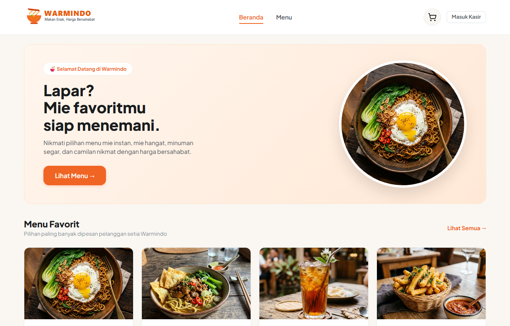 | 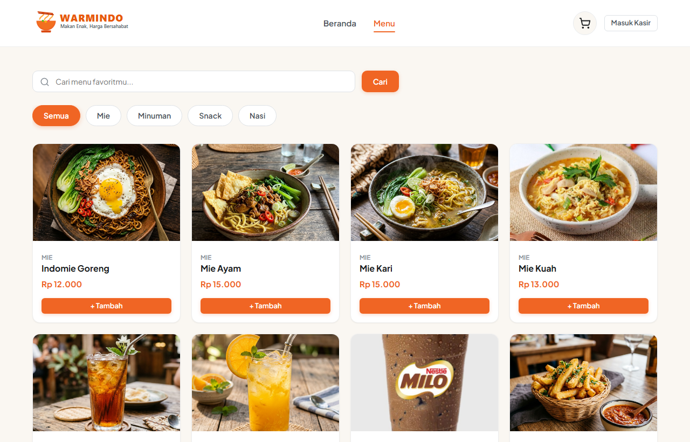 |

---

### 2.2 Autentikasi & Operasional Kasir
| 03. Halaman Login Multi-Role (`/login`) | 04. Dashboard Operasional Kasir (`/kasir`) |
| :---: | :---: |
| 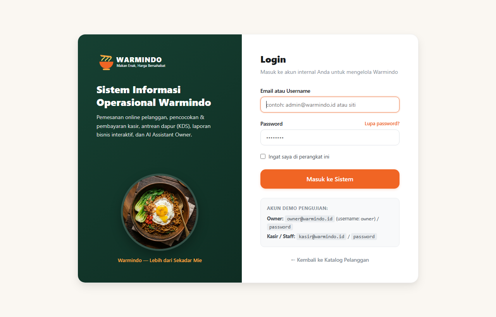 | 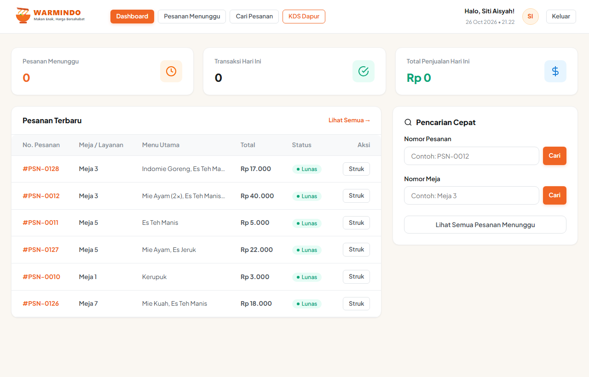 |

| 05. Daftar Tunggu & Pembayaran Kasir (`/kasir/waiting`) | 06. Kitchen Display System Dapur (`/dapur`) |
| :---: | :---: |
| 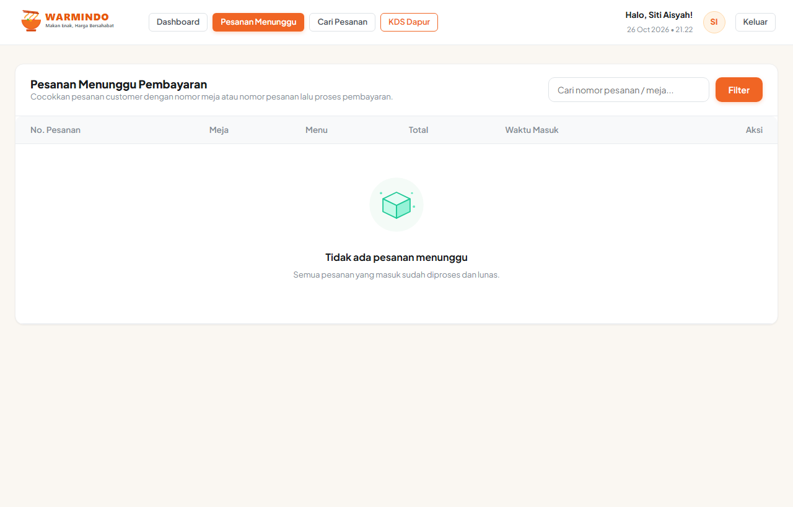 | 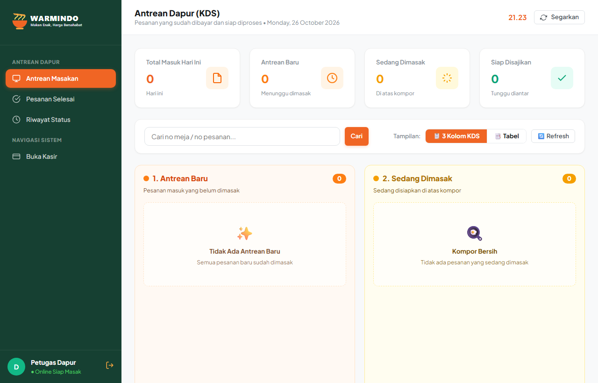 |

---

### 2.3 Dashboard & Manajemen Admin / Owner
| 07. Dashboard Bisnis & Metrik Penjualan (`/admin`) | 08. Master Produk & Peringatan Stok Menipis (`/admin/products`) |
| :---: | :---: |
| 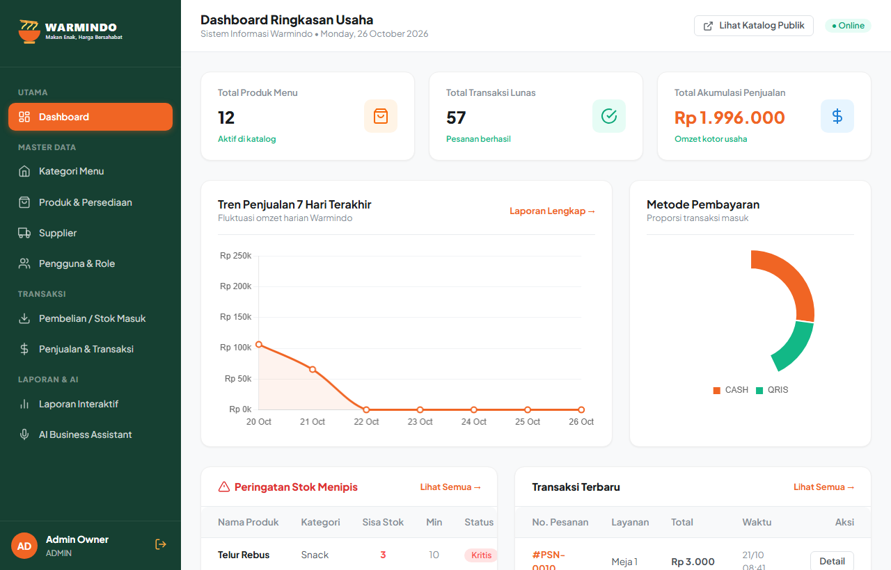 | 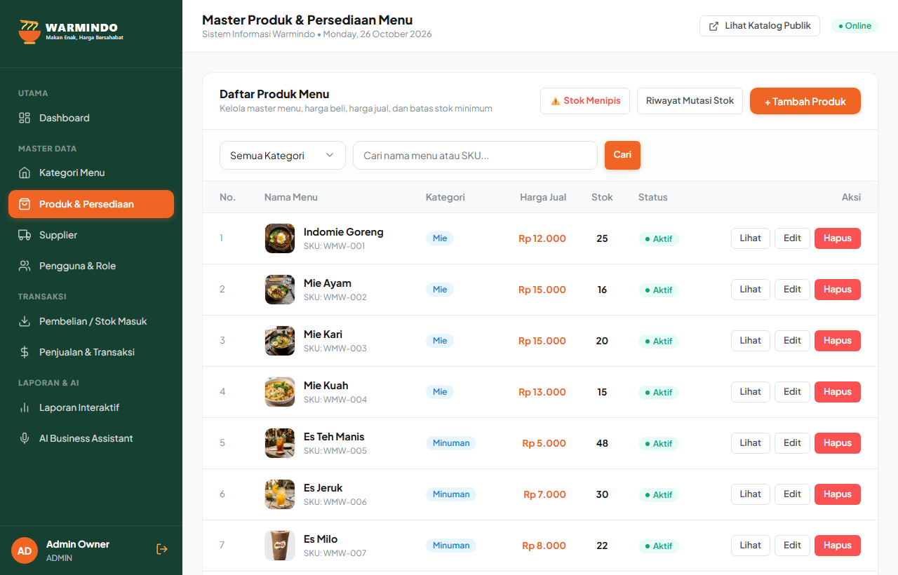 |

| 09. Pembelian Stok Masuk dari Pemasok (`/admin/purchases`) | 10. 7 Laporan Interaktif & Ekspor CSV (`/admin/reports`) |
| :---: | :---: |
| 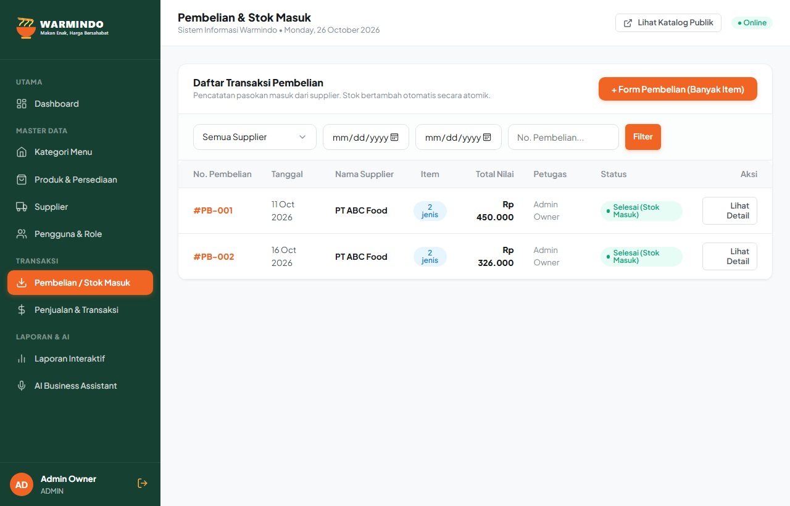 | 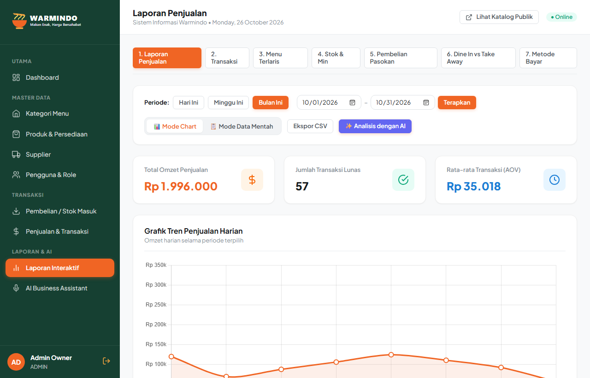 |

---

## 3. System Requirements

- **PHP:** Versi `>= 8.1` (Mendukung PHP 8.1, 8.2, 8.3)
- **Ekstensi PHP Wajib:** `pdo_mysql`, `mbstring`, `openssl`, `tokenizer`, `xml`, `ctype`, `json`, `fileinfo`, `gd`
- **Database:** MySQL `>= 8.0` atau MariaDB `>= 10.4` (Wajib InnoDB)
- **Dependency Manager:** Composer `>= 2.2`
- **Web Server:** Apache (Laragon / XAMPP) atau Nginx

---

## 4. Installation (Langkah Instalasi)

Proyek ini dirancang agar dapat dijalankan secara mandiri (*reproducible setup*):

```bash
# 1. Kloning repository GitHub
git clone https://github.com/rafifproject/UTS_Warmindo.git
cd UTS_Warmindo

# 2. Instal dependensi PHP via Composer
composer install

# 3. Salin file environment
cp .env.example .env

# 4. Generate application key
php artisan key:generate
```

---

## 5. Environment Setup

Buka file `.env` dan atur koneksi database MySQL:

```env
APP_NAME=Warmindo
APP_ENV=local
APP_KEY=base64:1MyLyPfjZXd+RrKKRcDdkQYP2OGK9JWuBTAB32/KkA4=
APP_DEBUG=true
APP_URL=http://localhost:8000

DB_CONNECTION=mysql
DB_HOST=127.0.0.1
DB_PORT=3306
DB_DATABASE=warmindo
DB_USERNAME=root
DB_PASSWORD=

CACHE_DRIVER=file
SESSION_DRIVER=file
```

---

## 6. Database Migration & Seeding

Jalankan perintah berikut untuk membuat skema tabel dan mengisi data awal:

```bash
php artisan migrate:fresh --seed
```

Perintah di atas akan menyiapkan:
1. Skema 10 tabel inti sistem.
2. Akun demo bawaan (Owner Warmindo, Staf Kasir, dan Staf Dapur).
3. 4 Kategori produk (Mie, Minuman, Snack, Nasi).
4. 12 Menu produk dengan foto resolusi tinggi, harga beli, harga jual, dan stok awal.
5. 3 Data pemasok (supplier) bahan baku.
6. Histori pembelian bahan baku dan transaksi penjualan awal.

Untuk menjalankan server pengujian:
```bash
php artisan serve
```

---

## 7. Demo Accounts (Akun Pengujian)

Semua akun demo menggunakan password bawaan: `password`

| Peran (Role) | Email | Username | Password | Wewenang & Batasan Akses |
| :--- | :--- | :--- | :--- | :--- |
| **Owner Warmindo** | `owner@warmindo.id` | `owner` | `password` | **Full Control (Pemilik):** Master Data (Kategori, Produk, Pemasok), Pembelian Bahan (*Stock-In*), Riwayat & Pembatalan Penjualan (*Stock Restore*), Manajemen Akun Staf, 7 Laporan Interaktif, AI Business Assistant. |
| **Staff (Kasir)** | `kasir@warmindo.id` | `siti` | `password` | **Operasional Kasir:** Dashboard kasir, antrean belum lunas, pembayaran tunai/QRIS/transfer, kalkulator kembalian, cetak struk. (*Pemotongan stok terjadi di sini secara atomik*). |
| **Staff (Dapur / KDS)** | `budi@warmindo.id` | `budi` | `password` | **Layar Dapur:** Menerima antrean pesanan yang **sudah lunas**, menggeser status pengerjaan (*Diterima ➔ Dimasak ➔ Siap Saji ➔ Selesai*). |
| **Customer** | *(Tanpa Login)* | *(Tamu)* | *(Tanpa Auth)* | **Pemesanan Mandiri:** Beranda, katalog filter, keranjang, pilihan layanan Dine In (wajib meja) / Take Away, checkout instan. |

---

## 8. Features & Alur Modul Sistem

Sistem mengintegrasikan seluruh alur operasional Warmindo:

### 8.1 Alur Publik (Pemesanan Pelanggan)
1. **Katalog & Detail Menu:** Menampilkan 12 menu Warmindo dengan status ketersediaan, filter kategori, dan pencarian cepat.
2. **Keranjang Dinamis:** Mengatur kuantitas item, catatan per menu, dan subtotal harga.
3. **Pilihan Layanan Meja:**
   - **Dine In:** Wajib menginput nomor meja pelanggan.
   - **Take Away:** Nomor meja otomatis diset `NULL`.
4. **Checkout Mandiri:** Sistem membuat nomor pesanan unik (misal: `#PSN-0001`) dengan status `waiting_payment`.

### 8.2 Alur Kasir (Pembayaran & Pemotongan Stok)
1. **Pencarian Pesanan:** Kasir mencari pesanan berdasarkan nomor meja atau nomor struk.
2. **Kalkulator Pembayaran:** Mendukung Tunai, QRIS, dan Transfer Bank. Terdapat tombol cepat (Rp 50.000, Rp 100.000, Uang Pas) serta validasi penolakan uang kurang.
3. **Pengurangan Stok Otomatis:** Begitu pembayaran lunas, sistem secara atomik memotong stok produk dan mencatat buku mutasi stok (`stock_mutations` tipe `out`).
4. **Struk Digital/Cetak:** Struk siap cetak untuk printer termal kasir.

### 8.3 Alur Dapur (Kitchen Display System - KDS)
1. **Pesanan Masuk Otomatis:** Hanya pesanan berstatus `paid` yang muncul di layar dapur.
2. **Stepper Pengerjaan:** Koki menggeser status pesanan: *Queued &rarr; Preparing &rarr; Ready to Serve &rarr; Completed*.
3. **Riwayat Log Dapur:** Mencatat timestamp dan nama staf yang memproses setiap tahapan.

### 8.4 Alur Owner & Inventori
1. **Master Data CRUD:** Kategori, Produk (SKU unik, harga beli/jual, stok, min-stock), dan Pemasok.
2. **Pembelian Bahan Baku (Purchases / Stock-In):** Form pembelian multi-item yang secara otomatis menambah stok produk (`increment('stock')`) dan mencatat mutasi `in`.
3. **Pembatalan Penjualan (Stock Restore):** Transaksi yang dibatalkan oleh Owner secara otomatis mengembalikan stok produk ke gudang.
4. **7 Laporan Interaktif:** Laporan Penjualan, Transaksi, Menu Terlaris, Stok, Pembelian, Dine In vs Take Away, dan Pembayaran (dengan fitur toggle Chart visual, Tabel data mentah, dan Ekspor CSV).
5. **AI Business Assistant:** Analitik bisnis otomatis untuk membaca metrik omzet dan rekomendasi restock bahan baku.

---

## 9. Known Limitations (Batasan Sistem)

Sesuai ruang lingkup ketentuan UTS pada Slide 4:
1. **Simulasi Pembayaran Kasir:** Pembayaran QRIS/Transfer divalidasi manual oleh kasir, bukan gateway pembayaran otomatis pihak ketiga (*no real third-party payment gateway*).
2. **Single Warehouse:** Pengelolaan persediaan ditujukan untuk satu outlet fisik Warmindo.
3. **Perhitungan Finansial Sederhana:** Menghitung laba kotor dari selisih harga jual dan harga beli (bukan modul akuntansi double-entry penuh).
4. **Mata Uang Tunggal:** Seluruh transaksi menggunakan mata uang Rupiah (IDR).
5. **Aplikasi Web Responsif:** Berbasis web murni tanpa aplikasi native mobile terpisah.

---

## 10. Rancangan Database, ERD & Kamus Data

### 10.1 Diagram Entity Relationship (ERD)

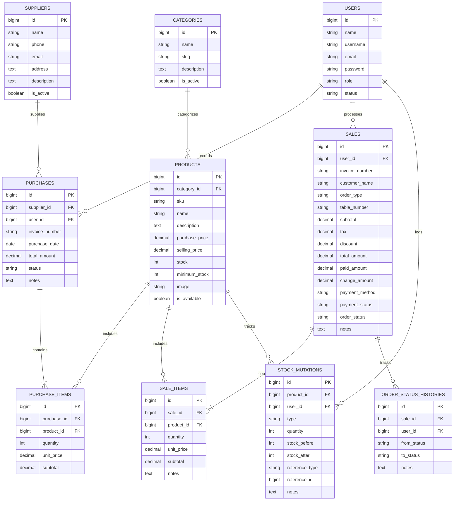

### 10.2 Kamus Data Relasi Antar Tabel Utama

| Nama Tabel | Primary Key | Foreign Key | Keterangan Relasi |
| :--- | :--- | :--- | :--- |
| **`users`** | `id` | - | Menyimpan akun Owner dan Staf (Kasir/Dapur). |
| **`categories`** | `id` | - | Satu kategori memiliki banyak produk menu (`hasMany Products`). |
| **`products`** | `id` | `category_id` &rarr; `categories(id)` | Menu terikat ke 1 kategori (`belongsTo Category`). Memiliki relasi ke `purchase_items` dan `sale_items`. Menggunakan `SoftDeletes`. |
| **`suppliers`** | `id` | - | Satu supplier menyuplai banyak transaksi pembelian stok (`hasMany Purchases`). |
| **`purchases`** | `id` | `supplier_id` &rarr; `suppliers(id)`<br>`user_id` &rarr; `users(id)` | Header nota belanja pasokan stok dari pemasok/supplier. Memiliki relasi ke `purchase_items`. |
| **`purchase_items`**| `id` | `purchase_id` &rarr; `purchases(id)`<br>`product_id` &rarr; `products(id)` | Detail kuantitas, harga beli modal satuan, dan subtotal per item barang masuk. |
| **`sales`** | `id` | `user_id` &rarr; `users(id)` | Header struk transaksi penjualan pelanggan. Memiliki relasi ke `sale_items` dan `order_status_histories`. |
| **`sale_items`** | `id` | `sale_id` &rarr; `sales(id)`<br>`product_id` &rarr; `products(id)` | Detail menu yang dipesan, catatan racikan porsi, harga jual saat transaksi, kuantitas, dan subtotal. |
| **`stock_mutations`**| `id` | `product_id` &rarr; `products(id)`<br>`user_id` &rarr; `users(id)` | Audit trail riwayat pergerakan stok (tipe: `in`, `out`, `adjustment`, saldo sebelum dan sesudah). |
| **`order_status_histories`**| `id` | `sale_id` &rarr; `sales(id)`<br>`user_id` &rarr; `users(id)` | Riwayat waktu dan staf yang mengubah tahapan masakan di dapur KDS. |

> **Catatan Akademis (Slide 10):** Foreign key selalu diletakkan pada tabel *child/detail* (`purchase_items`, `sale_items`) karena relasi bersifat *One-to-Many* (1 struk memiliki banyak rincian item pesanan).

---

### 10.3 Kamus Data Lengkap Bahasa Indonesia (Penjelasan Seluruh Kolom & Isinya)

Seluruh kolom tabel database telah dilengkapi dengan atribut `COMMENT` native MySQL berbahasa Indonesia sehingga saat dibuka melalui **phpMyAdmin**, **DBeaver**, **HeidiSQL**, maupun **Navicat**, arti dan fungsi setiap kolom langsung terbaca jelas dalam Bahasa Indonesia.

#### 1. Tabel `users` (Pengguna Sistem)
| Nama Kolom Fisik | Tipe Data MySQL | Nilai Bawaan / Atribut | Arti & Keterangan Kolom (Bahasa Indonesia) | Contoh Isi Kolom |
| :--- | :--- | :--- | :--- | :--- |
| `id` | `bigint unsigned` | PK, Auto Increment | Nomor ID unik pengguna sistem | `1`, `2` |
| `name` | `varchar(255)` | Not Null | Nama lengkap pemilik atau karyawan | `Owner Warmindo`, `Staf Kasir` |
| `username` | `varchar(255)` | Not Null, Unique | Username login akun | `owner`, `kasir` |
| `email` | `varchar(255)` | Not Null, Unique | Alamat surat elektronik (email) unik | `owner@warmindo.local` |
| `email_verified_at`| `timestamp` | Nullable | Waktu verifikasi alamat email | `2026-10-26 12:00:00` |
| `password` | `varchar(255)` | Not Null | Kata sandi login terenkripsi hash Bcrypt | `$2y$10$...` |
| `role` | `enum('owner','staff')` | Default: `'staff'` | Peran hak akses: `owner` (pemilik), `staff` (karyawan kasir & dapur) | `'owner'`, `'staff'` |
| `status` | `enum('active','inactive')` | Default: `'active'` | Status keaktifan akun: `active` (aktif), `inactive` (nonaktif) | `'active'` |
| `remember_token` | `varchar(100)` | Nullable | Token pengingat sesi login persisten | `token_str` |
| `created_at` | `timestamp` | Nullable | Waktu pencatatan akun dibuat | `2026-10-26 10:00:00` |
| `updated_at` | `timestamp` | Nullable | Waktu terakhir akun diperbarui | `2026-10-26 10:00:00` |

#### 2. Tabel `categories` (Kategori Menu)
| Nama Kolom Fisik | Tipe Data MySQL | Nilai Bawaan / Atribut | Arti & Keterangan Kolom (Bahasa Indonesia) | Contoh Isi Kolom |
| :--- | :--- | :--- | :--- | :--- |
| `id` | `bigint unsigned` | PK, Auto Increment | Nomor ID unik kategori menu | `1`, `2` |
| `name` | `varchar(255)` | Not Null | Nama kategori menu | `Mie`, `Minuman`, `Snack`, `Nasi` |
| `slug` | `varchar(255)` | Not Null, Unique | Teks URL ramah SEO (*Slug*) | `mie`, `minuman`, `snack` |
| `description` | `text` | Nullable | Penjelasan keterangan kategori menu | `Aneka racikan mie khas Warmindo` |
| `is_active` | `tinyint(1)` | Default: `1` | Status aktif kategori: `1` (aktif), `0` (nonaktif) | `1` |
| `created_at` | `timestamp` | Nullable | Waktu kategori ditambahkan | `2026-10-26 10:00:00` |
| `updated_at` | `timestamp` | Nullable | Waktu kategori diperbarui | `2026-10-26 10:00:00` |

#### 3. Tabel `products` (Katalog Menu & Produk)
| Nama Kolom Fisik | Tipe Data MySQL | Nilai Bawaan / Atribut | Arti & Keterangan Kolom (Bahasa Indonesia) | Contoh Isi Kolom |
| :--- | :--- | :--- | :--- | :--- |
| `id` | `bigint unsigned` | PK, Auto Increment | Nomor ID unik menu/produk | `1`, `2`, `3` |
| `category_id` | `bigint unsigned` | FK &rarr; `categories(id)` | ID kategori tempat menu bernaung | `1` |
| `sku` | `varchar(255)` | Not Null, Unique | Kode unik menu / barcode barang | `MIE-001`, `MIN-001` |
| `name` | `varchar(255)` | Not Null | Nama sajian menu makanan atau minuman | `Indomie Goreng Dok-Dok Spesial` |
| `description` | `text` | Nullable | Uraian racikan resep & bahan saus/topping | `Racikan Indomie kuah kental telur...` |
| `purchase_price` | `decimal(12,2)` | Default: `0.00` | Biaya modal racikan / harga beli bahan (HPP) | `7000.00` |
| `selling_price` | `decimal(12,2)` | Not Null | Harga jual menu per porsi ke pelanggan | `15000.00` |
| `stock` | `int` | Default: `0` | Sisa kuantitas stok porsi yang siap disajikan | `50` |
| `minimum_stock` | `int` | Default: `5` | Batas stok minimum untuk memicu peringatan restock | `10` |
| `image` | `varchar(255)` | Nullable | Nama file foto menu pada direktori sistem | `indomie-goreng-dokdok.png` |
| `is_available` | `tinyint(1)` | Default: `1` | Ketersediaan menu: `1` (bisa dipesan), `0` (habis) | `1` |
| `created_at` | `timestamp` | Nullable | Waktu menu didaftarkan ke sistem | `2026-10-26 10:00:00` |
| `updated_at` | `timestamp` | Nullable | Waktu menu terakhir diedit | `2026-10-26 10:00:00` |
| `deleted_at` | `timestamp` | Nullable (*Soft Delete*) | Waktu menu dihapus lunak (*Soft Delete*) | `NULL` |

#### 4. Tabel `suppliers` (Pemasok Bahan Baku)
| Nama Kolom Fisik | Tipe Data MySQL | Nilai Bawaan / Atribut | Arti & Keterangan Kolom (Bahasa Indonesia) | Contoh Isi Kolom |
| :--- | :--- | :--- | :--- | :--- |
| `id` | `bigint unsigned` | PK, Auto Increment | Nomor ID unik rekanan supplier | `1` |
| `name` | `varchar(255)` | Not Null | Nama badan usaha / nama supplier bahan baku | `Distributor Sembako Jaya` |
| `phone` | `varchar(255)` | Nullable | Nomor telepon atau WhatsApp kontak pemasok | `08123456789` |
| `email` | `varchar(255)` | Nullable | Alamat email resmi rekanan pemasok | `supplier@sembakojaya.com` |
| `address` | `text` | Nullable | Alamat fisik gudang / toko pemasok | `Jl. Malioboro No. 12, Yogyakarta` |
| `description` | `text` | Nullable | Rincian komoditas bahan yang dipasok | `Pemasok mie instan, telur, dan bumbu` |
| `is_active` | `tinyint(1)` | Default: `1` | Status keaktifan rekanan: `1` (aktif), `0` (nonaktif) | `1` |
| `created_at` | `timestamp` | Nullable | Waktu supplier didaftarkan | `2026-10-26 10:00:00` |
| `updated_at` | `timestamp` | Nullable | Waktu data supplier diubah | `2026-10-26 10:00:00` |

#### 5. Tabel `purchases` (Nota Pembelian Stok Masuk)
| Nama Kolom Fisik | Tipe Data MySQL | Nilai Bawaan / Atribut | Arti & Keterangan Kolom (Bahasa Indonesia) | Contoh Isi Kolom |
| :--- | :--- | :--- | :--- | :--- |
| `id` | `bigint unsigned` | PK, Auto Increment | Nomor ID unik transaksi pembelian pasokan | `1` |
| `supplier_id` | `bigint unsigned` | FK &rarr; `suppliers(id)` | ID rekanan supplier yang memasok bahan | `1` |
| `user_id` | `bigint unsigned` | FK &rarr; `users(id)` | ID user owner yang menginput nota belanja | `1` |
| `invoice_number` | `varchar(255)` | Not Null, Unique | Nomor nota / faktur pembelian dari supplier | `PO-20261026-0001` |
| `purchase_date` | `date` | Not Null | Tanggal nota pembelian | `2026-10-26` |
| `total_amount` | `decimal(14,2)` | Default: `0.00` | Total nominal belanja bahan masuk (Rp) | `350000.00` |
| `notes` | `text` | Nullable | Catatan pengiriman atau keterangan barang | `Restock mie dok-dok 50 porsi` |
| `status` | `enum('pending','received','cancelled')` | Default: `'received'` | Status nota: `received` (stok diterima), `pending`, `cancelled` | `'received'` |
| `created_at` | `timestamp` | Nullable | Waktu nota pembelian disimpan | `2026-10-26 10:00:00` |
| `updated_at` | `timestamp` | Nullable | Waktu status nota diubah | `2026-10-26 10:00:00` |

#### 6. Tabel `purchase_items` (Rincian Item Pembelian)
| Nama Kolom Fisik | Tipe Data MySQL | Nilai Bawaan / Atribut | Arti & Keterangan Kolom (Bahasa Indonesia) | Contoh Isi Kolom |
| :--- | :--- | :--- | :--- | :--- |
| `id` | `bigint unsigned` | PK, Auto Increment | Nomor ID unik rincian item pembelian | `1` |
| `purchase_id` | `bigint unsigned` | FK &rarr; `purchases(id)` | ID nota induk transaksi pembelian | `1` |
| `product_id` | `bigint unsigned` | FK &rarr; `products(id)` | ID produk menu/bahan yang dibeli | `1` |
| `quantity` | `int` | Not Null | Jumlah kuantitas stok barang masuk | `50` |
| `unit_price` | `decimal(12,2)` | Not Null | Harga beli modal satuan saat pembelian (Rp) | `7000.00` |
| `subtotal` | `decimal(14,2)` | Not Null | Subtotal baris item (`quantity` &times; `unit_price`) | `350000.00` |
| `created_at` | `timestamp` | Nullable | Waktu baris rincian dicatat | `2026-10-26 10:00:00` |
| `updated_at` | `timestamp` | Nullable | Waktu baris rincian diubah | `2026-10-26 10:00:00` |

#### 7. Tabel `sales` (Struk Transaksi Penjualan)
| Nama Kolom Fisik | Tipe Data MySQL | Nilai Bawaan / Atribut | Arti & Keterangan Kolom (Bahasa Indonesia) | Contoh Isi Kolom |
| :--- | :--- | :--- | :--- | :--- |
| `id` | `bigint unsigned` | PK, Auto Increment | Nomor ID unik transaksi penjualan kasir | `1` |
| `invoice_number` | `varchar(255)` | Not Null, Unique | Nomor struk nota transaksi pesanan | `TRX-20261026-0001` |
| `user_id` | `bigint unsigned` | Nullable, FK &rarr; `users(id)`| ID staf kasir yang melayani pesanan | `2` |
| `customer_name` | `varchar(255)` | Nullable | Nama pelanggan / pemesan | `Mas Budi Santoso` |
| `order_type` | `enum('dine_in','take_away')`| Default: `'dine_in'` | Tipe layanan: `dine_in` (makan ditempat), `take_away` (bungkus) | `'dine_in'` |
| `table_number` | `varchar(255)` | Nullable | Nomor meja (khusus makan ditempat) | `'Meja 03'` |
| `subtotal` | `decimal(14,2)` | Default: `0.00` | Total harga pesanan sebelum potongan/pajak (Rp) | `30000.00` |
| `tax` | `decimal(12,2)` | Default: `0.00` | Nominal pajak penjualan (jika ada) (Rp) | `0.00` |
| `discount` | `decimal(12,2)` | Default: `0.00` | Nilai potongan diskon promo (Rp) | `0.00` |
| `total_amount` | `decimal(14,2)` | Default: `0.00` | Total tagihan akhir yang wajib dibayar (Rp) | `30000.00` |
| `paid_amount` | `decimal(14,2)` | Default: `0.00` | Nominal uang tunai yang dibayar pelanggan (Rp) | `50000.00` |
| `change_amount` | `decimal(14,2)` | Default: `0.00` | Nominal uang kembalian pelanggan (Rp) | `20000.00` |
| `payment_method` | `enum('cash','qris','transfer')`| Default: `'cash'` | Cara bayar: `cash` (tunai), `qris` (QRIS), `transfer` | `'cash'` |
| `payment_status` | `enum('unpaid','paid')`| Default: `'unpaid'` | Status bayar: `unpaid` (menunggu bayar), `paid` (lunas) | `'paid'` |
| `order_status` | `enum('pending','cooking','ready','completed','cancelled')` | Default: `'pending'` | Tahapan proses dapur KDS: `pending` &rarr; `cooking` &rarr; `ready` &rarr; `completed` | `'completed'` |
| `notes` | `text` | Nullable | Catatan khusus pesanan pelanggan | `'Mie dok-dok pedas sedang, es teh manis'` |
| `created_at` | `timestamp` | Nullable | Waktu pesanan pertama kali dibuat | `2026-10-26 12:30:00` |
| `updated_at` | `timestamp` | Nullable | Waktu terakhir status pesanan diubah | `2026-10-26 12:45:00` |

#### 8. Tabel `sale_items` (Rincian Item Menu Pesanan)
| Nama Kolom Fisik | Tipe Data MySQL | Nilai Bawaan / Atribut | Arti & Keterangan Kolom (Bahasa Indonesia) | Contoh Isi Kolom |
| :--- | :--- | :--- | :--- | :--- |
| `id` | `bigint unsigned` | PK, Auto Increment | Nomor ID unik rincian item menu pesanan | `1` |
| `sale_id` | `bigint unsigned` | FK &rarr; `sales(id)` | ID nota induk transaksi penjualan | `1` |
| `product_id` | `bigint unsigned` | FK &rarr; `products(id)` | ID menu yang dipesan pelanggan | `1` |
| `quantity` | `int` | Not Null | Jumlah porsi menu yang dipesan | `2` |
| `unit_price` | `decimal(12,2)` | Not Null | Harga per porsi saat transaksi berlangsung (Rp) | `15000.00` |
| `subtotal` | `decimal(14,2)` | Not Null | Subtotal baris menu (`quantity` &times; `unit_price`) | `30000.00` |
| `notes` | `varchar(255)` | Nullable | Catatan racikan khusus per porsi | `'Level 3 pedas, telur setengah matang'` |
| `created_at` | `timestamp` | Nullable | Waktu item pesanan disimpan | `2026-10-26 12:30:00` |
| `updated_at` | `timestamp` | Nullable | Waktu item pesanan diubah | `2026-10-26 12:30:00` |

#### 9. Tabel `stock_mutations` (Buku Besar Audit Mutasi Stok)
| Nama Kolom Fisik | Tipe Data MySQL | Nilai Bawaan / Atribut | Arti & Keterangan Kolom (Bahasa Indonesia) | Contoh Isi Kolom |
| :--- | :--- | :--- | :--- | :--- |
| `id` | `bigint unsigned` | PK, Auto Increment | Nomor ID unik mutasi stok | `1` |
| `product_id` | `bigint unsigned` | FK &rarr; `products(id)` | ID produk menu yang mengalami pergerakan stok | `1` |
| `user_id` | `bigint unsigned` | Nullable, FK &rarr; `users(id)`| ID pengguna yang memicu pergerakan stok | `2` |
| `type` | `enum('in','out','adjustment')`| Not Null | Jenis arus stok: `in` (masuk), `out` (keluar), `adjustment` (opname) | `'out'` |
| `quantity` | `int` | Not Null | Jumlah selisih pergerakan stok | `2` |
| `stock_before` | `int` | Not Null | Saldo kuantitas stok sebelum transaksi terjadi | `50` |
| `stock_after` | `int` | Not Null | Saldo kuantitas stok akhir setelah transaksi | `48` |
| `reference_type` | `varchar(255)` | Nullable | Jenis dokumen rujukan: `'sale'`, `'purchase'`, `'adjustment'` | `'sale'` |
| `reference_id` | `bigint unsigned` | Nullable | ID nomor transaksi pada tabel rujukan | `1` |
| `notes` | `text` | Nullable | Penjelasan keterangan penyebab perubahan stok | `'Penjualan Nota #TRX-20261026-0001'` |
| `created_at` | `timestamp` | Nullable | Waktu pencatatan mutasi stok terjadi | `2026-10-26 12:30:00` |

#### 10. Tabel `order_status_histories` (Log Tahapan Dapur KDS)
| Nama Kolom Fisik | Tipe Data MySQL | Nilai Bawaan / Atribut | Arti & Keterangan Kolom (Bahasa Indonesia) | Contoh Isi Kolom |
| :--- | :--- | :--- | :--- | :--- |
| `id` | `bigint unsigned` | PK, Auto Increment | Nomor ID unik catatan riwayat tahapan dapur | `1` |
| `sale_id` | `bigint unsigned` | FK &rarr; `sales(id)` | ID transaksi pesanan yang dipantau di dapur | `1` |
| `user_id` | `bigint unsigned` | Nullable, FK &rarr; `users(id)`| ID koki / kasir yang mengubah tahapan | `2` |
| `from_status` | `varchar(255)` | Nullable | Tahapan pesanan sebelum diubah | `'pending'` |
| `to_status` | `varchar(255)` | Not Null | Tahapan pesanan yang baru diset | `'cooking'` |
| `notes` | `text` | Nullable | Catatan proses pembuatan makanan | `'Pesanan sedang diracik dan dimasak di dapur'` |
| `created_at` | `timestamp` | Nullable | Waktu perubahan tahapan status dapur | `2026-10-26 12:32:00` |

---

## 11. Business Rules & Integritas Transaksi

Sistem mematuhi aturan bisnis ketat (Slide 8):
1. **Keunikan SKU:** Diuji ganda di level validasi form (`unique:products,sku`) dan *unique index* tabel MySQL.
2. **Validasi Kuantitas & Harga:** Kuantitas transaksi wajib integer `> 0`, harga satuan `>= 0`.
3. **Pencegahan Overselling & Atomisitas:**
   ```php
   DB::transaction(function () use ($penjualan, $request) {
       $produk = Produk::lockForUpdate()->findOrFail($item->product_id);
       if ($produk->stock < $item->quantity) {
           throw new \Exception('Stok tidak mencukupi.');
       }
       $produk->decrement('stock', $item->quantity);
       // Catat mutasi stok out...
   });
   ```
4. **Perhitungan Server-Side:** Total harga dihitung langsung dari harga produk resmi di database dikalikan kuantitas (menolak manipulasi nilai dari browser).
5. **Pemulihan Stok saat Batal:** Pembatalan penjualan oleh Admin mengembalikan stok produk ke gudang secara otomatis (`increment('stock')`).
6. **Perlindungan Data Historis:** Produk menggunakan **Soft Deletes** sehingga menu yang pernah terjual tidak dihapus permanen dari basis data.

---

## 12. Test Scenario & Bukti Hasil Pengujian

Pengujian dilakukan menggunakan Automated Feature Test Suite (`php artisan test`) yang mencakup seluruh skenario Slide 19:

| No | Skenario Uji | Tindakan Pengujian | Hasil yang Diharapkan | Status |
| :-: | :--- | :--- | :--- | :---: |
| 1 | **Auth** | Tamu mengakses `/admin` atau `/kasir` tanpa login | Redirect ke `/login` | **PASS** |
| 2 | **Auth Failure** | Login dengan password salah | Ditolak dengan pesan error inline | **PASS** |
| 3 | **Authorization** | Akun Staff membuka menu Owner (`/admin/users`) | Ditolak dengan status `403 Forbidden` | **PASS** |
| 4 | **Dine In Service** | Checkout Dine In tanpa menginput nomor meja | Validasi gagal, wajib isi nomor meja | **PASS** |
| 5 | **Take Away Service**| Checkout Take Away | Nomor meja otomatis disimpan `NULL` | **PASS** |
| 6 | **Payment Validation**| Kasir input uang tunai kurang dari tagihan | Transaksi ditolak, modal peringatan muncul | **PASS** |
| 7 | **Sale Stock-out** | Kasir konfirmasi pembayaran pesanan | Stok produk berkurang tepat & mutasi tercatat | **PASS** |
| 8 | **Sale Cancel** | Owner membatalkan transaksi penjualan lunas | Stok produk bertambah kembali (*restored*) | **PASS** |
| 9 | **Owner Reports** | Akses 7 modul laporan bisnis | Grafik & data mentah termuat sempurna | **PASS** |
| 10 | **AI Assistant** | Generate analitik rekomendasi bisnis | Ringkasan performa dan stok tampil sukses | **PASS** |

### Log Hasil Eksekusi Test:
```text
   PASS  Tests\Unit\ExampleTest
  ✓ that true is true

   PASS  Tests\Feature\ExampleTest
  ✓ the application returns a successful response

   PASS  Tests\Feature\WarmindoBusinessLogicTest
  ✓ unauthenticated user cannot access internal dashboards
  ✓ login with invalid credentials fails
  ✓ staff cannot access user management receives 403
  ✓ dine in checkout requires table number
  ✓ take away checkout sets table number to null
  ✓ cashier rejects insufficient cash payment
  ✓ cashier payment confirmation reduces stock atomically
  ✓ admin cancel paid sale restores stock
  ✓ admin can access reports
  ✓ ai business assistant generates analysis

  Tests:    12 passed (37 assertions)
  Duration: 1.15s
```

---

## 13. Panduan & Kunci Jawaban Code Interview

Pertanyaan-pertanyaan di bawah ini dirancang khusus untuk menghadapi evaluasi dosen (Slide 24):

### Q1: Mengapa `Sale` memiliki relasi `hasMany` ke `SaleItem`?
> **Jawaban:** Dalam satu transaksi penjualan (*1 struk*), pelanggan bisa memesan banyak variasi menu dengan jumlah yang berbeda-beda (*banyak item*). Oleh karena itu, data transaksi umum (nomor nota, total biaya, metode bayar) disimpan di tabel induk `sales`, sedangkan rincian per menu (nama menu, harga saat beli, kuantitas, subtotal) disimpan di tabel anak `sale_items` dengan relasi satu ke banyak (*hasMany*).

### Q2: Di mana sistem memastikan stok tidak menjadi negatif?
> **Jawaban:** Pemeriksaan dilakukan di Controller sebelum stok dipotong:
> ```php
> if ($produk->stock < $item->quantity) {
>     throw new \Exception('Stok tidak mencukupi.');
> }
> ```
> Dipadukan dengan validasi form kuantitas minimal 1 (`min:1`).

### Q3: Mengapa total penjualan dihitung di server?
> **Jawaban:** Input dari browser sangat mudah dimanipulasi melalui fitur *Inspect Element* atau Postman. Untuk mencegah penipuan harga, server mengambil harga satuan resmi langsung dari database (`$produk->sell_price`) lalu mengalikannya dengan kuantitas yang divalidasi.

### Q4: Apa risiko jika pengurangan stok dilakukan di luar `DB::transaction()`?
> **Jawaban:** Risiko terjadinya **data setengah tersimpan (*inkonsistensi data*)**. Jika sistem error saat memotong stok item ke-3, penjualan sudah tercatat lunas tetapi stok sebagian produk tidak berkurang. Dengan `DB::transaction()`, bila terjadi satu kesalahan, seluruh operasi akan di-rollback ke kondisi awal.

### Q5: Bagaimana mencegah Staff mengakses fungsi Owner melalui URL langsung?
> **Jawaban:** Menggunakan **Middleware Otorisasi** di file `routes/web.php`:
> ```php
> Route::middleware(['auth', 'role:admin'])->prefix('admin')->group(...);
> ```
> Jika akun staf mencoba mengetikkan `/admin/users` di URL browser, sistem langsung mencegatnya dengan respon `403 Forbidden`.

### Q6: Apa yang terjadi jika dua penjualan memproses stok produk yang sama hampir bersamaan?
> **Jawaban:** Dapat terjadi *Race Condition* di mana kedua kasir membaca stok yang sama padahal stok hanya tersisa satu. Sistem mengatasinya dengan **Pessimistic Locking**:
> ```php
> $produk = Produk::lockForUpdate()->find($id);
> ```
> Perintah ini mengunci baris data di MySQL sehingga transaksi kedua harus mengantre sampai transaksi pertama selesai melakukan `commit`.

### Q7: Tunjukkan validasi SKU unik dan jelaskan peran constraint database.
> **Jawaban:**
> - Di level controller: `'sku' => 'required|string|max:50|unique:products,sku'`
> - Di level migrasi database: `$table->string('sku', 50)->unique();`
> - **Peran Constraint:** Constraint database bertindak sebagai benteng pertahanan terakhir (*defense in depth*). Jika validasi aplikasi terlewat, MySQL sendiri yang akan menolak penyimpanan data jika ada SKU ganda.

### Q8: Bagaimana cara kerja aturan minimum stock (`min_stock`)?
> **Jawaban:** Pada model `Produk.php` terdapat fungsi:
> ```php
> public function isLowStock(): bool {
>     return $this->stock <= $this->min_stock;
> }
> ```
> Indikator ini digunakan oleh Dashboard Owner untuk menampilkan badge peringatan merah secara otomatis saat stok fisik telah berada di bawah batas aman pemesanan ulang.

---

## 📜 Lisensi & Integritas Akademik
Project ini dikembangkan secara orisinal dengan mematuhi ketentuan akademik mata kuliah **Web Programming 2**.  
*Makan Enak, Harga Bersahabat — Warmindo Lebih dari Sekadar Mie.*
