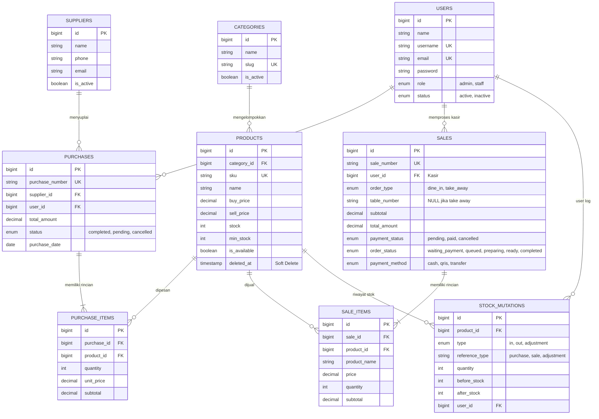

# 🍜 Sistem Informasi Warmindo Terintegrasi
### Integrated Laravel Project: Inventory & Sales Management System
> **Mata Kuliah: Web Programming 2 — Ujian Tengah Semester (UTS)**  
> **Teknologi:** Laravel 10.x • MySQL 8.0 • Eloquent ORM • Blade Engine • Vanilla CSS & JS • PHP 8.1+

---

## 📑 Daftar Isi
1. [1. Project Overview](#1-project-overview)
2. [2. System Requirements](#2-system-requirements)
3. [3. Installation (Langkah Instalasi)](#3-installation-langkah-instalasi)
4. [4. Environment Setup](#4-environment-setup)
5. [5. Database Migration & Seeding](#5-database-migration--seeding)
6. [6. Demo Accounts (Akun Pengujian)](#6-demo-accounts-akun-pengujian)
7. [7. Features & Modul Wajib](#7-features--modul-wajib)
8. [8. Known Limitations (Batasan Sistem)](#8-known-limitations-batasan-sistem)
9. [9. Rancangan Database, ERD & Relasi Eloquent](#9-rancangan-database-erd--relasi-eloquent)
10. [10. Business Rules & Integritas Transaksi](#10-business-rules--integritas-transaksi)
11. [11. Test Scenario & Bukti Hasil Pengujian](#11-test-scenario--bukti-hasil-pengujian)
12. [12. Panduan & Jawaban Code Ownership Interview](#12-panduan--jawaban-code-ownership-interview)

---

## 1. Project Overview

### 1.1 Latar Belakang & Skenario Bisnis
Aplikasi ini dikembangkan untuk memecahkan masalah operasional pada usaha kuliner dan distribusi **Warmindo (Warung Makan Indomie)** yang sebelumnya masih menggunakan pencatatan manual:
- **Ketidaksesuaian Stok Fisik:** Stok tidak tercatat secara *real-time* saat terjadi pembelian barang masuk atau penjualan ke pelanggan.
- **Overselling:** Menu yang stok bahannya sudah habis masih bisa dipesan oleh pelanggan.
- **Kesulitan Penelusuran Riwayat:** Sulit melacak transaksi lampau, arus kas masuk/keluar, dan mutasi stok.
- **Ketiadaan Pembatasan Akses:** Staf kasir berpotensi mengakses atau mengubah data sensitif pemilik (*owner*).
- **Ketiadaan Ringkasan Bisnis:** Pemilik tidak memiliki ringkasan analitik penjualan harian, tren menu terlaris, dan peringatan stok menipis.

### 1.2 Tujuan Sistem
Membangun sistem informasi bisnis terpadu yang menjamin **konsistensi stok**, **keamanan transaksi atomik**, dan **pemisahan hak akses berbasis peran (Role-Based Access Control)**.

### 1.3 Arsitektur Sistem (Laravel MVC)
Sistem mematuhi hierarki arsitektur web Laravel modern:
```text
Browser (HTTP Request)
   ↓
Route (routes/web.php - Named Routes & Resource Routes)
   ↓
Middleware ('auth', 'role:admin,staff' - Server-side Authorization)
   ↓
Controller (Menangani request & alur data)
   ↓
Form Request / Server-side Validation ($request->validate())
   ↓
Business Logic & DB::transaction() (Atomic operations & Pessimistic Locking)
   ↓
Eloquent Model & Database MySQL (Relasi, Mutasi Stok, Soft Deletes)
   ↓
Blade View Response (Layout Reusable, Pesan Sukses/Error Inline)
```

---

## 2. System Requirements

Sebelum menjalankan aplikasi, pastikan komputer/server telah memenuhi spesifikasi berikut:
- **PHP:** Versi `>= 8.1` (Direkomendasikan PHP 8.1 / 8.2)
- **Ekstensi PHP Wajib:** `pdo_mysql`, `mbstring`, `openssl`, `tokenizer`, `xml`, `ctype`, `json`, `fileinfo`, `gd`
- **Database Engine:** MySQL `>= 8.0` atau MariaDB `>= 10.4` (Mendukung InnoDB, Foreign Key, dan Transaction)
- **Dependency Manager:** Composer `>= 2.2`
- **Web Server:** Apache (Laragon / XAMPP) atau Nginx / `php artisan serve`
- **Web Browser:** Google Chrome, Mozilla Firefox, atau Microsoft Edge versi terbaru

---

## 3. Installation (Langkah Instalasi)

Aplikasi dirancang agar dapat dijalankan secara mandiri (*reproducible setup*) pada *environment* baru:

```bash
# 1. Kloning repository dari GitHub
git clone https://github.com/your-username/warmindo.git
cd warmindo

# 2. Pasang seluruh dependensi PHP via Composer
composer install

# 3. Buat salinan berkas konfigurasi lingkungan
cp .env.example .env

# 4. Generate application encryption key
php artisan key:generate
```

---

## 4. Environment Setup

Buka berkas `.env` dan sesuaikan kredensial koneksi database MySQL lokal Anda:

```env
APP_NAME=Warmindo
APP_ENV=local
APP_KEY=base64:1MyLyPfjZXd+RrKKRcDdkQYP2OGK9JWuBTAB32/KkA4=
APP_DEBUG=true
APP_URL=http://localhost:8000

DB_CONNECTION=mysql
DB_HOST=127.0.0.1
DB_PORT=3306
DB_DATABASE=warmindo
DB_USERNAME=root
DB_PASSWORD=

# Cache & Session
CACHE_DRIVER=file
SESSION_DRIVER=file
QUEUE_CONNECTION=sync
```

> **Catatan Keamanan:** Berkas `.env` asli tidak boleh di-commit ke Git. Hanya template `.env.example` yang masuk ke dalam *version control*.

---

## 5. Database Migration & Seeding

Database dibuat secara terstruktur melalui skema migrasi (*migration-first*) dan dilengkapi data dummy realistis melalui *seeder*:

```bash
# Jalankan migrasi tabel dan seeding data awal secara bersih
php artisan migrate:fresh --seed
```

Perintah di atas secara otomatis membuat:
1. Skema seluruh tabel (Users, Categories, Products, Suppliers, Purchases, Purchase Items, Sales, Sale Items, Stock Mutations, Order Status Histories).
2. Akun pengguna bawaan (Admin, Kasir, Dapur).
3. 4 Kategori menu (Mie, Minuman, Snack, Nasi).
4. 12 Produk menu realistis dengan SKU, harga beli, harga jual, stok, dan minimum stock.
5. 3 Data supplier terdaftar beserta kontak.
6. Riwayat data pembelian bahan baku dan penjualan awal.

---

## 6. Demo Accounts (Akun Pengujian)

Untuk keperluan pengujian fungsionalitas dan demo kode interview, gunakan akun demo berikut (semua password: `password`):

| Role / Peran | Email | Username | Password | Otoritas & Hak Akses |
| :--- | :--- | :--- | :--- | :--- |
| **Admin / Owner** | `admin@warmindo.id` | `admin` | `password` | **Akses Penuh:** CRUD Master Data (Kategori, Produk, Pemasok), Transaksi Pembelian (*Stock-In*), Riwayat & Pembatalan Penjualan (*Stock Restore*), Manajemen Staf/User, 7 Laporan Interaktif, AI Business Assistant. |
| **Staff (Kasir)** | `kasir@warmindo.id` | `kasir` | `password` | **Operasional Kasir:** Dashboard kasir, antrean belum lunas, pencarian meja/pesanan, kalkulasi bayar tunai & kembalian, pemotongan stok otomatis (*Stock-Out*), cetak struk fisik/digital. |
| **Staff (Dapur / KDS)** | `budi@warmindo.id` | `budi` | `password` | **Kitchen Display:** Menerima pesanan yang telah lunas, update tahapan masakan (*Queued &rarr; Preparing &rarr; Ready &rarr; Completed*), riwayat log dapur. |
| **Publik (Customer)** | *(Tanpa Login)* | *(Tamu)* | *(Tanpa Auth)* | **Pemesanan Mandiri:** Akses Beranda, Katalog Menu, Keranjang, Pemilihan Layanan Dine In / Take Away, Checkout nomor pesanan unik. |

Untuk menjalankan server pengujian lokal:
```bash
php artisan serve
```
Buka browser pada: `http://127.0.0.1:8000/`

---

## 7. Features & Modul Wajib

Sistem telah mengimplementasikan seluruh **8 Modul Wajib** dari spesifikasi UTS:

### 1. Modul Autentikasi & Otorisasi
- Login multi-role (`admin`, `staff`), logout aman dengan regenerasi sesi.
- Proteksi password hashing menggunakan `bcrypt`.
- Middleware proteksi server-side: Tamu dicegah mengakses dashboard internal; staf dicegah membuka URL admin.

### 2. Modul Kategori (Categories)
- CRUD kategori menu (Nama kategori unik, slug otomatis, deskripsi, status aktif).
- Pencegahan penghapusan jika kategori masih memiliki relasi produk aktif.

### 3. Modul Produk & Persediaan (Products & Inventory)
- SKU unik wajib, penentuan harga beli (*buy price*) dan harga jual (*sell price*).
- Pengelolaan stok fisik dan ambang batas stok minimum (*minimum stock*).
- Tanda produk favorit untuk halaman beranda.
- Mekanisme **Soft Deletes** agar data historis transaksi lama tidak rusak.

### 4. Modul Pemasok (Suppliers)
- Master data supplier bahan baku (Nama perusahaan, person in charge, telepon, email, alamat).
- Riwayat transaksi pembelian yang terhubung ke masing-masing pemasok.

### 5. Modul Pembelian (Purchases / Stock-In)
- Multi-item form: Memilih supplier dan menambahkan beberapa produk sekaligus dalam 1 nota pembelian.
- Penambahan stok otomatis secara instan setelah pembelian dikonfirmasi.
- Pencatatan buku audit mutasi stok masuk (`stock_mutations` tipe `in`).

### 6. Modul Penjualan (Sales / Stock-Out)
- Pemesanan mandiri oleh pelanggan (Dine In dengan nomor meja atau Take Away).
- Verifikasi kasir, pemilihan metode bayar (Tunai, QRIS, Transfer), validasi uang tunai cukup/kurang, dan cetak struk.
- Pengurangan stok otomatis secara atomik saat pembayaran berhasil dikonfirmasi.
- Pencatatan buku audit mutasi stok keluar (`stock_mutations` tipe `out`).
- Fitur **Pembatalan Penjualan oleh Admin** dengan pengembalian stok (*stock restore*) secara otomatis.

### 7. Modul Dashboard Ringkas
- Metrik kartu agregat real-time: Total produk aktif, total omzet penjualan hari ini/bulan ini, volume transaksi.
- Widget peringatan stok menipis (*low stock alert*) berbasis `stock <= min_stock`.
- Grafik tren penjualan mingguan dan diagram lingkaran metode pembayaran.

### 8. Modul Pencarian & Laporan (Search, Filter, Pagination, Report)
- Pencarian produk berdasarkan SKU atau nama; filter pesanan berdasarkan tanggal, status, dan meja.
- Pagination server-side (`paginate()`) dengan query string yang dipertahankan antar halaman (`withQueryString()`).
- **7 Laporan Bisnis Interaktif (Dual Mode: Chart Visual & Data Mentah)** beserta ekspor CSV.
- **AI Business Assistant** untuk analisis performa produk dan saran persediaan otomatis.

---

## 8. Known Limitations (Batasan Sistem)

Sesuai ruang lingkup ketentuan UTS pada Slide 4, sistem ini berfokus pada **integritas logika web, transaksi, dan konsistensi stok**, dengan batasan:
1. **Simulasi Pembayaran:** Pembayaran non-tunai (QRIS / Transfer) menggunakan simulasi verifikasi kasir internal, bukan integrasi payment gateway pihak ketiga nyata (*no real external payment gateway*).
2. **Single Warehouse / Toko Tunggal:** Pengelolaan persediaan ditujukan untuk satu outlet Warmindo fisik (bukan *multi-warehouse* terdistribusi).
3. **Pencatatan Keuangan Sederhana:** Fokus pencatatan laba kotor dari selisih harga jual dan harga beli (bukan modul akuntansi double-entry penuh).
4. **Mata Uang Tunggal:** Seluruh transaksi dicatat dan dihitung dalam mata uang Rupiah (IDR).
5. **Web-Based Responsive:** Aplikasi diakses melalui browser komputer/tablet/smartphone dan tidak menyediakan aplikasi native mobile terpisah.

---

## 9. Rancangan Database, ERD & Relasi Eloquent

### 9.1 Diagram Entity Relationship (ERD)



### 9.2 Penjelasan Relasi Eloquent
- **Category `hasMany` Product & Product `belongsTo` Category:** Satu kategori menaungi banyak produk. Foreign key `category_id` berada di tabel `products`.
- **Supplier `hasMany` Purchase & Purchase `belongsTo` Supplier:** Satu supplier dapat melakukan banyak transaksi pasokan barang ke toko.
- **Purchase `hasMany` PurchaseItem & PurchaseItem `belongsTo` Purchase:** Dalam satu nota pembelian terdapat banyak item barang. Foreign key `purchase_id` berada di `purchase_items`.
- **Sale `hasMany` SaleItem & SaleItem `belongsTo` Sale:** Dalam satu struk belanja pelanggan dapat memesan banyak macam menu. Foreign key `sale_id` berada di `sale_items`.
- **Product `hasMany` SaleItems & Product `hasMany` PurchaseItems:** Satu produk dapat tercatat di berbagai histori penjualan dan pembelian.
- **Mengapa Foreign Key berada pada tabel detail?** Karena relasi bersifat *One-to-Many*. Tabel *child/detail* dapat memiliki banyak baris yang masing-masing merujuk ke satu baris induk (*parent*). Jika foreign key ditaruh di tabel induk, akan terjadi pelanggaran normalisasi database (1NF).

---

## 10. Business Rules & Integritas Transaksi

Sistem menerapkan aturan bisnis ketat sesuai instruksi Slide 8:
1. **Keunikan SKU:** Setiap produk wajib memiliki SKU unik yang dilindungi di level validasi form dan *unique constraint* MySQL.
2. **Validasi Kuantitas & Harga:** Kuantitas transaksi wajib integer `> 0`. Harga tidak boleh bernilai negatif (`min:0`).
3. **Pencegahan Overselling & Atomicity:**
   ```php
   DB::transaction(function () use ($penjualan, $request) {
       $produk = Produk::lockForUpdate()->findOrFail($item->product_id);
       if ($produk->stock < $item->quantity) {
           throw new \Exception('Stok tidak mencukupi.');
       }
       $produk->decrement('stock', $item->quantity);
       // Catat mutasi stok...
   });
   ```
   Penggunaan `lockForUpdate()` mencegah *race condition* jika dua transaksi memproses produk yang sama secara bersamaan.
4. **Perhitungan Sisi Server:** Total harga dihitung langsung dari harga produk di database dikalikan kuantitas, bukan mempercayai nilai rupiah kiriman browser.
5. **Aturan Pembatalan Transaksi:** Transaksi yang dibatalkan oleh Admin akan mengembalikan stok produk ke gudang secara konsisten (`increment('stock')`) dan mencatat mutasi `in/adjustment`.
6. **Perlindungan Data Historis:** Produk menggunakan **Soft Deletes** (`SoftDeletes`) sehingga produk yang pernah terjual tidak dihapus permanen dari basis data (*hard delete*).

---

## 11. Test Scenario & Bukti Hasil Pengujian

Pengujian dilakukan menggunakan Automated Feature Tests (`php artisan test`) yang memvalidasi skenario minimum sesuai Slide 19:

| No | Skenario Uji | Deskripsi Uji | Target Hasil | Status |
| :-: | :--- | :--- | :--- | :---: |
| 1 | **Auth** | Tamu membuka URL `/admin` atau `/kasir` tanpa login | Redirect ke `/login` | **PASS** |
| 2 | **Auth Failure** | Login dengan password salah | Ditolak dengan pesan error | **PASS** |
| 3 | **Authorization** | Akun Staff membuka menu Admin (`/admin/users`) | Ditahan dengan respon `403 Forbidden` | **PASS** |
| 4 | **Dine In Service** | Pemesanan Dine In tanpa menginput nomor meja | Validasi gagal, wajib isi nomor meja | **PASS** |
| 5 | **Take Away Service**| Pemesanan Take Away | Nomor meja otomatis `NULL` | **PASS** |
| 6 | **Payment Validation**| Pembayaran tunai kasir kurang dari total tagihan | Transaksi ditolak, muncul modal peringatan | **PASS** |
| 7 | **Sale Stock-out** | Kasir menyelesaikan pembayaran pesanan | Stok produk berkurang tepat & mutasi tercatat | **PASS** |
| 8 | **Sale Cancel** | Admin membatalkan penjualan berstatus lunas | Stok produk bertambah kembali (*restored*) | **PASS** |
| 9 | **Admin Reports** | Akses 7 modul laporan bisnis | Data dan grafik termuat tanpa error | **PASS** |
| 10 | **AI Assistant** | Generate analitik rekomendasi bisnis | Respon analisis metriks berhasil ditampilkan | **PASS** |

### Bukti Eksekusi Pengujian:
```text
   PASS  Tests\Unit\ExampleTest
  ✓ that true is true

   PASS  Tests\Feature\ExampleTest
  ✓ the application returns a successful response

   PASS  Tests\Feature\WarmindoBusinessLogicTest
  ✓ unauthenticated user cannot access internal dashboards
  ✓ login with invalid credentials fails
  ✓ staff cannot access user management receives 403
  ✓ dine in checkout requires table number
  ✓ take away checkout sets table number to null
  ✓ cashier rejects insufficient cash payment
  ✓ cashier payment confirmation reduces stock atomically
  ✓ admin cancel paid sale restores stock
  ✓ admin can access reports
  ✓ ai business assistant generates analysis

  Tests:    12 passed (37 assertions)
```

---

## 12. Panduan & Jawaban Code Ownership Interview

Pertanyaan-pertanyaan di bawah ini dirancang khusus untuk menghadapi sesi wawancara dosen (Slide 24):

### Q1: Mengapa `Sale` memiliki relasi `hasMany` ke `SaleItem`?
> **Jawaban:** Satu struk transaksi penjualan (*Sale*) dapat memuat banyak variasi menu (*SaleItem*) yang dipesan oleh pelanggan. Oleh karena itu, entitas utama (nomor transaksi, total harga, metode bayar) disimpan di tabel `sales`, sedangkan rincian per menu (nama menu, harga satuan saat dibeli, kuantitas, subtotal) disimpan di tabel `sale_items` dengan relasi satu ke banyak (*hasMany*).

### Q2: Di mana sistem memastikan stok tidak menjadi negatif?
> **Jawaban:** Pemeriksaan dilakukan di dua lapisan:
> 1. Validasi kuantitas input form bertipe integer `min:1`.
> 2. Pengecekan server-side sebelum pemotongan stok pada Controller (`KontrollerKasir.php` & `KontrollerKeranjang.php`):
> ```php
> if ($produk->stock < $item->quantity) {
>     throw new \Exception('Stok tidak mencukupi.');
> }
> ```

### Q3: Mengapa total penjualan dihitung di server?
> **Jawaban:** Input dari browser (seperti data form HTML atau variabel JavaScript) rentan dimanipulasi melalui fitur *Inspect Element* atau tool API eksternal. Untuk mencegah kecurangan harga, server mengambil harga resmi langsung dari database (`$produk->sell_price`) lalu mengalikannya dengan kuantitas yang divalidasi.

### Q4: Apa risiko jika pengurangan stok dilakukan di luar `DB::transaction()`?
> **Jawaban:** Risiko terjadinya **inkonsistensi data / data setengah tersimpan**. Jika sistem mengalami kegagalan (misalnya database mati atau script error di tengah proses pemotongan item kedua), penjualan sudah terlanjur tercatat lunas tetapi stok sebagian produk tidak berkurang. Dengan `DB::transaction()`, bila terjadi satu kesalahan saja, seluruh aksi akan di-rollback ke kondisi semula.

### Q5: Bagaimana mencegah Staff mengakses fungsi Admin melalui URL langsung?
> **Jawaban:** Menggunakan middleware otorisasi server-side di file `routes/web.php`:
> ```php
> Route::middleware(['auth', 'role:admin'])->prefix('admin')->group(...);
> ```
> Middleware memeriksa kolom `role` pada pengguna yang sedang login (`auth()->user()->role`). Jika bukan `admin`, sistem langsung menolak request dengan status `403 Forbidden`.

### Q6: Apa yang terjadi jika dua penjualan memproses stok produk yang sama hampir bersamaan?
> **Jawaban:** Tanpa penanganan khusus, akan terjadi *Race Condition* di mana kedua kasir membaca stok yang sama padahal stok hanya tersisa satu, sehingga menyebabkan stok minus. Sistem mengatasi ini menggunakan **Pessimistic Locking**:
> ```php
> $produk = Produk::lockForUpdate()->find($id);
> ```
> Perintah ini memberi lock pada baris database terkait sehingga transaksi kedua harus menunggu sampai transaksi pertama selesai melakukan `commit`.

### Q7: Tunjukkan validasi SKU unik dan jelaskan peran constraint database.
> **Jawaban:**
> - Di level controller: `'sku' => 'required|string|max:50|unique:products,sku'`
> - Di level migrasi database: `$table->string('sku', 50)->unique();`
> - **Peran Constraint:** Constraint database bertindak sebagai pertahanan terakhir (*defense in depth*). Jika terdapat celah atau proses asynchronous yang melewati validasi aplikasi, MySQL akan menolak eksekusi query penyimpanan dengan error *Integrity Constraint Violation*.

### Q8: Bagaimana cara kerja aturan minimum stock (`min_stock`)?
> **Jawaban:** Pada model `Produk.php` terdapat fungsi:
> ```php
> public function isLowStock(): bool {
>     return $this->stock <= $this->min_stock;
> }
> ```
> Indikator ini digunakan oleh Dashboard Admin dan halaman `/admin/products/low-stock` untuk menyaring dan menandai menu yang persediaannya telah mencapai titik kritis pemesanan ulang (*reorder point*).

---

## 📜 Lisensi & Integritas Akademik
Project ini dikerjakan secara orisinal dengan mematuhi prinsip integritas akademik mata kuliah **Web Programming 2**.  
*Warmindo — Lebih dari Sekadar Mie.*
